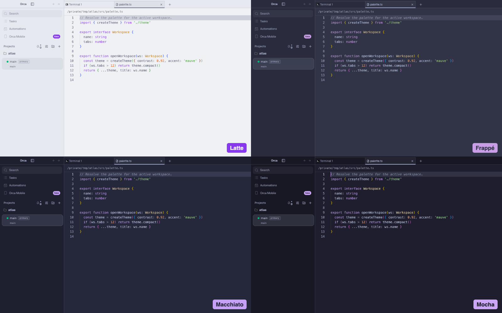

# Catppuccin for Orca

[Catppuccin](https://catppuccin.com/) app, editor and terminal themes for
[Orca](https://github.com/stablyai/orca), in all four flavors: Latte, Frappé, Macchiato and Mocha.
This is an unofficial port. The plugin lives in [`plugins/catppuccin`](plugins/catppuccin), and its
[README](plugins/catppuccin/README.md) lists what it adds and how it differs from upstream.



## Flavors

Each flavor themes the app, the editor's syntax colors and the terminal's 16 ANSI colors.
Mauve is the accent everywhere.

### Mocha

| Editor | Terminal |
| --- | --- |
|  |  |

### Macchiato

| Editor | Terminal |
| --- | --- |
|  |  |

### Frappé

| Editor | Terminal |
| --- | --- |
|  |  |

### Latte

| Editor | Terminal |
| --- | --- |
|  |  |

## Install

1. In Orca, open Settings → Plugins.
2. Open **Add plugin** → **From a Git URL…**.
3. Enter `https://github.com/vale-c/orca-catppuccin.git` with ref `main`, and install
   **Catppuccin for Orca**.
4. In Settings → Appearance, pick a Catppuccin flavor as the dark theme and another as the light
   theme. Pick the matching Catppuccin terminal themes in the terminal settings.

To try a local copy instead, use **Add plugin** → **From a folder…** and select the
`plugins/catppuccin` folder. Orca reloads the themes when the files change.

## Build and verify

The theme files in `plugins/catppuccin/themes` and `plugins/catppuccin/terminal` are generated.
Do not edit them by hand. Change `scripts/build.mjs` and rebuild instead.

```sh
node scripts/build.mjs           # regenerate the theme files from scripts/catppuccin-palette.json
node scripts/build.mjs --check   # exit 1 if a committed file is out of date
```

The build fails when an app token pair is under Orca's contrast floor. It prints every syntax
color it adjusted to reach 3:1 on the editor background.

To check the themes with Orca's own runtime code, point `ORCA_DIR` at an Orca checkout with its
dependencies installed:

```sh
ORCA_DIR=/path/to/orca node scripts/verify.mjs
cd /path/to/orca && node config/scripts/validate-plugin-files.mjs /path/to/orca-catppuccin/plugins/catppuccin
```

`verify.mjs` fails when Orca would drop a theme token or a syntax color, or reject a terminal theme.

`scripts/orca-e2e/catppuccin-theme.spec.ts` drives a real Orca build. It loads the plugin as a
development folder, selects each flavor, and checks the applied app tokens and editor token colors.
It opens a small demo project, `atlas`, created under `CATPPUCCIN_DEMO_DIR` and deleted afterwards,
and saves an editor and a terminal screenshot per flavor. The cover and `docs/screenshots` are made
from them. Copy it into the Orca
checkout's `tests/e2e/` and run:

```sh
CATPPUCCIN_PLUGIN_DIR=/path/to/orca-catppuccin/plugins/catppuccin CATPPUCCIN_SHOTS_DIR=/tmp/shots CATPPUCCIN_DEMO_DIR=/tmp \
  npx playwright test tests/e2e/catppuccin-theme.spec.ts --config tests/playwright.config.ts --project=electron-headless
```

## Release

`orca-catalog.json` pins each release to the last commit that changed `plugins/catppuccin` and to
the hash of its files. After a change to the plugin, bump `version` in its manifest, commit, then
run the Orca validator on the plugin folder. Paste the release entry it prints first in `releases`,
with `commit` set to `git log -1 --format=%H -- plugins/catppuccin`, and validate the catalog with
`node config/scripts/validate-plugin-files.mjs /path/to/orca-catppuccin/orca-catalog.json`.

## License

MIT. See [LICENSE](LICENSE). The Catppuccin palette is MIT licensed by Catppuccin, and its
notice is included in [plugins/catppuccin/LICENSE](plugins/catppuccin/LICENSE).
