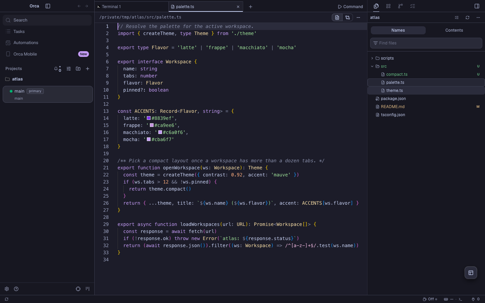
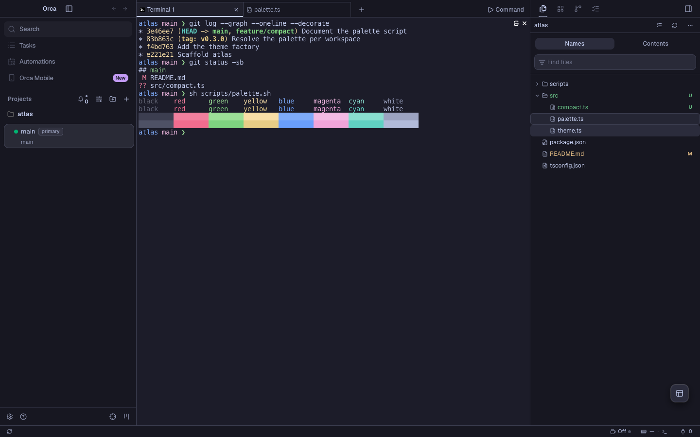
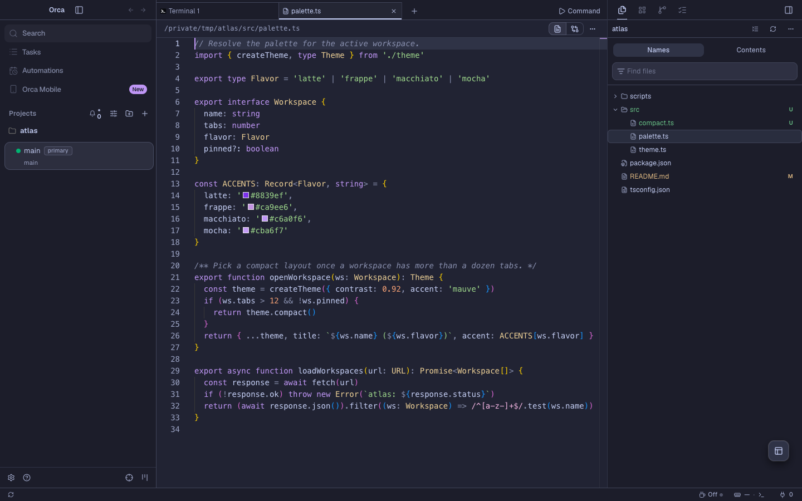
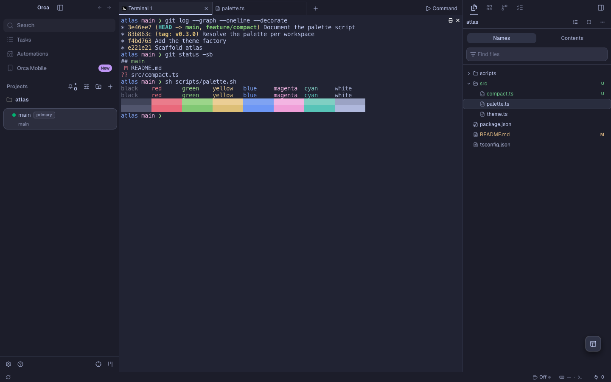
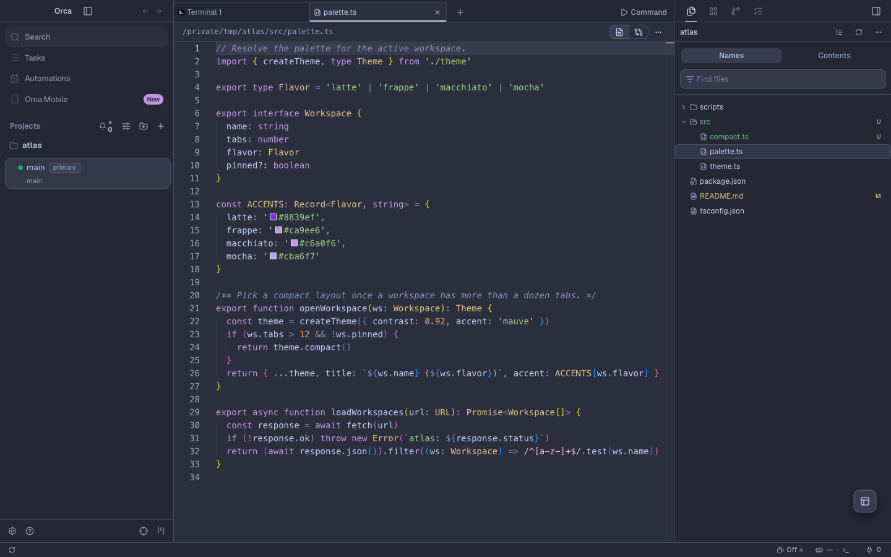
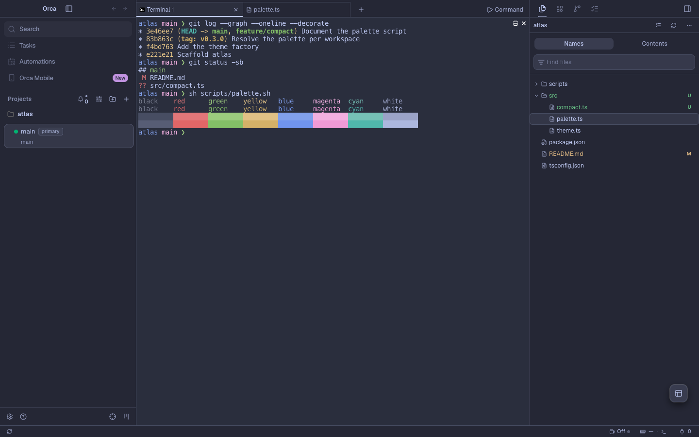
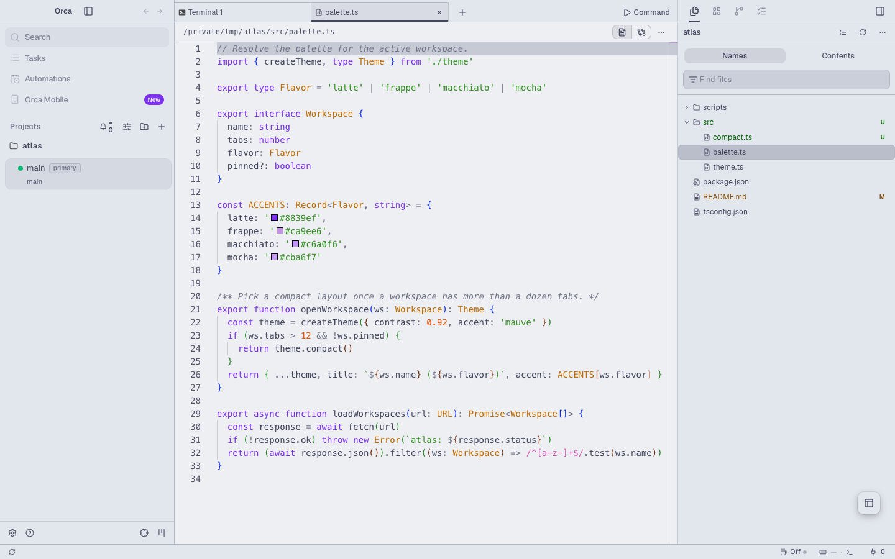
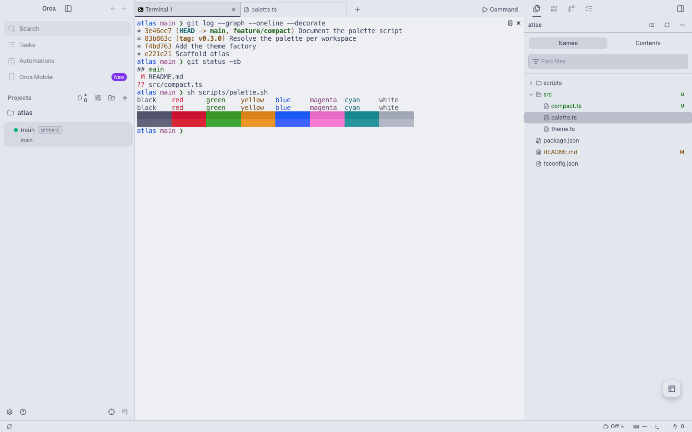

# Catppuccin for Orca

[Catppuccin](https://catppuccin.com/) app, editor and terminal themes for
[Orca](https://github.com/stablyai/orca), in all four flavors: Latte, Frappé, Macchiato and Mocha.
This is an unofficial port, built from Catppuccin palette v1.8.0.


## Flavors

Each flavor themes the app, the editor's syntax colors and the terminal's 16 ANSI colors.
Mauve is the accent everywhere. Latte is a light theme. Frappé, Macchiato and Mocha are dark themes.

### Mocha

| Editor | Terminal |
| --- | --- |
|  |  |

### Macchiato

| Editor | Terminal |
| --- | --- |
|  |  |

### Frappé

| Editor | Terminal |
| --- | --- |
|  |  |

### Latte

| Editor | Terminal |
| --- | --- |
|  |  |

## Install

Find **Catppuccin for Orca** in Orca's plugin directory and install it. To install it from this
repository instead:

1. In Orca, open Settings → Plugins.
2. Open **Add plugin** → **From a Git URL…**.
3. Enter `https://github.com/vale-c/orca-catppuccin.git` with ref `main`, and install
   **Catppuccin for Orca**.
4. In Settings → Appearance, pick a Catppuccin flavor as the dark theme and another as the light
   theme. Pick the matching Catppuccin terminal themes in the terminal settings.

To try a local copy instead, use **Add plugin** → **From a folder…** and select the
root folder of this repository. Orca reloads the themes when the files change.

## Differences from upstream

The app mapping and syntax scopes are maintained here and follow the
[Catppuccin style guide](https://github.com/catppuccin/catppuccin/blob/main/docs/style-guide.md).

Orca drops a syntax color under 3:1 contrast with the editor background, so these Latte syntax
colors are darkened in OKLCH lightness only, keeping chroma and hue:

| Color | Upstream | Shipped |
| --- | --- | --- |
| Rosewater | `#dc8a78` | `#c47463` |
| Pink | `#ea76cb` | `#d260b5` |
| Peach | `#fe640b` | `#f05700` |
| Yellow | `#df8e1d` | `#c77700` |
| Green | `#40a02b` | `#3d9d28` |
| Sky | `#04a5e5` | `#0092d1` |

Latte also uses Subtext 1 instead of Subtext 0 for muted text, because Subtext 0 on Base is under
Orca's 4.5:1 floor for text. Frappé, Macchiato and Mocha use the upstream palette unchanged.
Terminal ANSI colors use the upstream palette unchanged in every flavor.

## Build and verify

The theme files in `themes` and `terminal` are generated.
Do not edit them by hand. Change `scripts/build.mjs` and rebuild instead.

```sh
node scripts/build.mjs           # regenerate the theme files from scripts/catppuccin-palette.json
node scripts/build.mjs --check   # exit 1 if a committed file is out of date
```

The build fails when an app token pair is under Orca's contrast floor. It prints every syntax
color it adjusted to reach 3:1 on the editor background.

To check the themes with Orca's own runtime code, point `ORCA_DIR` at an Orca checkout with its
dependencies installed:

```sh
ORCA_DIR=/path/to/orca node scripts/verify.mjs
cd /path/to/orca && node config/scripts/validate-plugin-files.mjs /path/to/orca-catppuccin
```

`verify.mjs` fails when Orca would drop a theme token or a syntax color, or reject a terminal theme.

`scripts/orca-e2e/catppuccin-theme.spec.ts` drives a real Orca build. It loads the plugin as a
development folder, selects each flavor, and checks the applied app tokens and editor token colors.
It opens a small demo project, `atlas`, created under `CATPPUCCIN_DEMO_DIR` and deleted afterwards,
and saves an editor and a terminal screenshot per flavor. The cover and `docs/screenshots` are made
from them. Copy it into the Orca
checkout's `tests/e2e/` and run:

```sh
CATPPUCCIN_PLUGIN_DIR=/path/to/orca-catppuccin CATPPUCCIN_SHOTS_DIR=/tmp/shots CATPPUCCIN_DEMO_DIR=/tmp \
  npx playwright test tests/e2e/catppuccin-theme.spec.ts --config tests/playwright.config.ts --project=electron-headless
```

## Release

Orca's plugin directory lists the newest `vX.Y.Z` tag. To release a change:

1. Bump `version` in `orca-plugin.json` and commit.
2. Run the Orca validator on this folder. It prints the release entry for that commit.
3. Paste that entry first in `releases` in `orca-catalog.json`, and commit.
4. Validate the catalog with
   `node config/scripts/validate-plugin-files.mjs /path/to/orca-catppuccin/orca-catalog.json`.
5. Commit, then push the tag: `git tag v1.0.1 && git push origin main v1.0.1`.

`orca-catalog.json` is what **From a Git URL…** reads.

## License

MIT. See [LICENSE](LICENSE), which also includes the Catppuccin palette's MIT notice.
